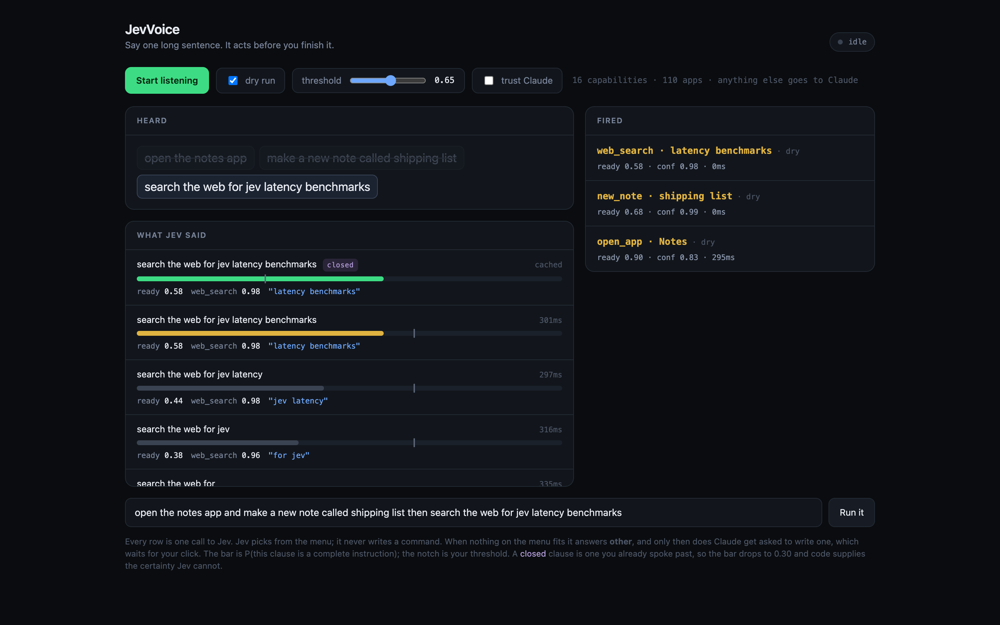
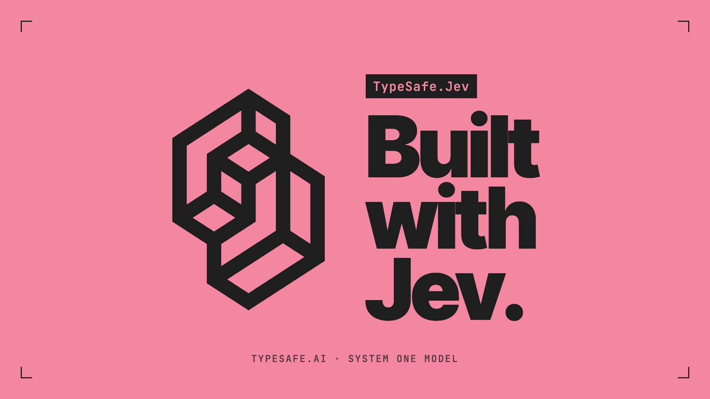

# JevVoice

**Talk to your Mac in one long run-on sentence. It acts on each instruction while you are still talking.**



## What it does

- **Acts mid-sentence.** "Open the notes app and make a new note called shipping list then search the web for..." opens Notes, makes the note and runs the search, each about half a second after you finish that part.
- **Knows every app you own.** Installed apps are scanned at startup and become options. No hardcoded list.
- **Asks Claude only when it has to.** Anything outside the menu goes to `claude -p`, which proposes one shell command that never runs until you click **Run it**.
- **Ships as a native Mac app.** SayOpen is a Swift menu-bar and notch app with a wake phrase, ~30 actions, in-app clicking through Accessibility, file search, and voice typing handoff.
- **Keeps speech on your Mac.** Recognition runs on-device through Apple's Speech framework. Only the transcript text leaves the machine.

## Benchmarks

Measured on a real Mac, against hand-written baselines that were finished before the bench was run.

**SayOpen: Jev vs a rules engine** (regexes, nickname table, edit distance)

| | Jev | Rules |
|---|---|---|
| 74 everyday commands (`mac-app/bench/actions.json`) | **69 / 74** | 44 / 74 |
| 15 unseen phrasings, never tuned on (`holdout.json`) | **14 / 15** | 7 / 15 |
| Hinglish ("awaaz kam karo", "chrome kholo") | **6 / 6** | 2 / 6 |
| Chatter correctly ignored ("terminal velocity is a great movie") | **8 / 8** | 5 / 8 |
| Median time per clause | ~400 ms | ~5 ms |

After adding in-app control and file search the main bench reads 65 to 68 of 74 across runs; run-to-run variance is about plus or minus 2.

**Launcher: say an app, it opens** (50 phrasings, 123 apps, `bench.json`)

| kind | hardcoded | Jev | hybrid |
|---|---|---|---|
| exact name | 8/8 | 8/8 | 8/8 |
| nickname | 9/10 | 10/10 | 10/10 |
| describe it ("the app I make 3d models in") | 4/14 | **13/14** | **13/14** |
| misheard ("tell a gram") | 6/8 | 7/8 | 7/8 |
| Hinglish | 4/5 | 5/5 | 5/5 |
| should open nothing | 4/5 | 5/5 | 5/5 |
| **all** | **70%** | **96%** | **96%** |

Hybrid opens exact names in 0 ms by code and asks Jev for everything else (~370 ms). The hardcoded column only scores 70% because its alias table was written by hand; every new app needs new lines there and nothing on the Jev side.

## How it works

```
mic -> listen (Swift, on-device speech) -> partial transcript every few words
                                               |
                         agent.py splits it into clauses at and / then / also
                                               |
                 oldest unfinished clause + the whole menu -> Jev (~450 ms)
                                               |
                       typed answers + probabilities ("ready", "confidence")
                          /                                         \
                  a capability                                   "other"
                       |                                            |
          code runs the command from skills.json      Claude writes one, you approve it
```

[Jev](https://typesafe.ai) is TypeSafe's System One model: it picks between typed options and returns probabilities instead of free text. That makes it a fast, safe router. The fast path is a picker, so it keeps up with speech. The slow path writes code, so it has no ceiling. Jev decides which one you get.

**`skills.json` is the menu.** A capability is a description, typed args and a command template. Adding one is config, not Python:

```json
{
  "id": "set_volume",
  "description": "Change the Mac's speaker volume up, down, to a level, or to silent.",
  "args": {"level": {"type": "enum", "options": {"half": {"value": "50", "desc": "half, medium, 50 percent"}}}},
  "run": ["osascript", "-e", "set volume output volume {level}"],
  "refine": true
}
```

Arg types are `span` (a phrase lifted from what you said), `app` (any installed app) and `enum`. Two flags came from live misfires:

- `"refine": true` lets an idempotent action fire at once and be corrected by later words: "turn the volume down" sets 20, "to half" corrects it to 50. Never on anything that creates something, or you get two notes.
- `"fallback": true` on an option means "only accept this once the clause closes", so "open a new tab in chrome" does not fire in the wrong browser the instant "open a new tab" becomes grammatical.

The threshold is the whole personality. Low fires early and sometimes wrong; high waits for the sentence to finish. 0.65 is measured, not a law. Each call is about 2,100 tokens, roughly $0.00009, so a spoken sentence costs about a tenth of a cent.

## Run it

Needs macOS, Python 3.11+, Xcode command line tools (`swiftc`) and a [TypeSafe API key](https://console.typesafe.ai/). The `claude` CLI is optional and only used for the "other" fallback.

```sh
python3 -m venv .venv
.venv/bin/pip install -r requirements.txt
cp .env.example .env          # paste your TYPESAFE_API_KEY

./web.sh                      # web UI on http://localhost:4700
```

On first run macOS asks your terminal for Microphone and Speech Recognition access. Approve both and run it again. The web UI starts in **dry run**: it decides but touches nothing. You can also type a sentence; it is replayed word by word exactly the way the mic delivers it.

Terminal versions:

```sh
./run.sh                      # listen and act
./run.sh --dry                # listen, decide, touch nothing
./run.sh --threshold 0.9      # act later, be surer
.venv/bin/python agent.py --say "open the notes app and make a new note titled hello" --dry

./open.sh                     # launcher: say an app, it opens
.venv/bin/python launcher.py --bench   # hardcoded vs jev vs hybrid on bench.json
```

### SayOpen, the native app

```sh
cd mac-app && ./build.sh      # builds build/SayOpen.app and build/SayOpen.dmg (universal)
python3 bench/run.py          # Jev vs Rules on bench/actions.json (needs TYPESAFE_API_KEY in env)
```

On first launch SayOpen asks for a TypeSafe key and saves it to a user-only file (mode 600) in Application Support; no key ships in the build. Control+Option+Space toggles listening, or say "Hey Mac" with the wake phrase on. `build.sh` signs with a local certificate if you create one in `mac-app/signing/`, otherwise it ad-hoc signs.

## Known limits

- **Speech recognition is the weak link, not Jev.** In a speaker-to-mic test it heard "monday standup" as "midday stand", and Jev faithfully titled the note that.
- **Only apps you have.** Asking for an app that is not installed is skipped with a reason rather than silently ignored.
- **No undo.** Use dry run first.
- **Not notarised.** A downloaded SayOpen build needs Privacy & Security, Open Anyway, once.
- **Notes get a title only.** Dictating a note body is not built.

## Layout

```
listen.swift      on-device speech, prints {"text", "final"} per hypothesis
agent.py          clauses, Jev questions, thresholds, dispatch (also the CLI)
server.py         Flask + SSE web UI over the same agent (index.html)
skills.json       the capability menu
launcher.py       single-job "say an app, it opens" with hardcoded / jev / hybrid modes
mac-app/src/      SayOpen: Core, Speech, Actions, JevEngine, Rules, Brain, UIAgent, UI, Main
mac-app/bench/    Jev vs Rules benchmark cases and results
slide/            title cards
```

## Tech stack

Python (Flask, Server-Sent Events), Swift (AppKit, Speech, Accessibility, CoreAudio), TypeSafe Jev via `typesafe-sdk`, Claude Code CLI fallback, macOS.

<p align="center"></p>
